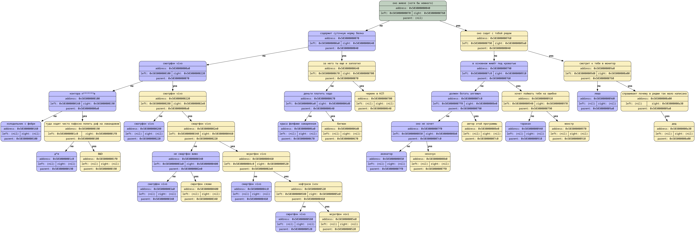

# bitree (бинарное дерево)

## Описание
Данный проект содержит в себе реализацию бинарного дерева на языке программирования C, также игру "Акинатор" на основе этой структуры данных.

При разработке был сделан сильный акцент на универсальное использование структуры дерева. Дерево полностью поддерживает compile-time полиморфизм и имеет возможность гибкой конфигурации.

Помимо этого дерево поддерживает графический дамп через `graphviz` для удобства отладки.

## Компиляция и запуск
> Для работы программы необходима утилита [dot](https://graphviz.org/download/) для создания графического дампа

Чтобы скомплировать Акинатора, запустите:
```bash
./compile_akinator.sh
```

Чтобы скомпилировать произвольный проект с использованием дерева, запустите
```bash
./compile.sh <your_program.c>
```
Если для дерева требуется кастомная кофигурация, то вторым аргументом можно указать путь до конфига
```bash
./compile.sh <your_program.c> path/to/config.h
```

## Архитектура проекта
Структура узла `Node`:
```c
typedef struct Node {
    bitree_elem_t value;

    #ifdef BT_USE_PARENT_FIELD 
    struct Node *parent;
    #endif

    struct Node *left;
    struct Node *right;
} Node;
```
> Флаг `BT_USE_PARENT_FIELD` не только создаёт соответствующее поле внутри `Node`, но и меняет поведение методов дерева.
>
> Его можно указать как в флагах компиляции через `-DBT_USE_PARENT_FIELD`, так и в конфигурационном `.h` файле, о котором пойдёт речь в разделе **Конфигурация**

Для дерева реализован ряд стандартных методов, полный список которых можно посмотреть в `inlcude/bitree.h`.
Примеры использования дерева можно также посмотреть в папке `tests`.

API большинства методов интутивно понятен, однако отдельно обсудим архитектуру метода `bt_walk()`

### Архитектура `bt_walk`
`bt_walk` имеет сигнатуру
```c
BiTreeStatus (Node *node, bt_walk_func_t func, void *ctx)
```
и производит рекурсивный обход дерева слева-направо.

Аргумент `node` указывает на начальный узел обхода. `bt_walk` вызывает `func` во время посещения узла (таким образом, для непустого узла `func` вызовется три раза, а для пустого один).
`func` принимает на вход три аргумента и имеет сигнатуру:
```c
bool (Node* node, BtWalkState state, void *ctx)
```
Первый аргумент - узел, который обходится. Второй аргумент - число, которое может быть одним из `BT_ENTER`, `BT_IN`, `BT_LEAVE` в зависимости от того это первое, второе или третье посещение узла соответственно. Или же, если узел пустой (`node == NULL`) функция вызывается с аргументом `BT_EMPTY`. Третий аргумет - указатель на переменную с контекстом, с которым работает `func`.

Помимо этого, `func` должен возвращать `true` или `false` в зависимости от того, нужно ли прервать на текущий момент обход или нет соответственно. Если обход был остановлен таким образом, `bt_walk` вернёт статус `BITREE_WALK_STOPPED`. Иначе вернётся `BITREE_OK`. С помощью этого, можно реализовывать поиск по дереву.

Это пример реализации распечатки (сериализации) дерева с помощью `bt_walk`:
```c
static bool bt_preorder_print(Node *node, BtWalkState state, void *ctx) {
    assert(ctx != NULL);

    FILE *file = (FILE *)ctx;

    switch (state) {
        case BT_ENTER:
            fputs("(", file);
            BT_SER_ELEM(node->value, file);
            break;
        case BT_IN:
            break;
        case BT_LEAVE:
            fputs(")", file);
            break;
        case BT_EMPTY:
            fputs("#", file);
            break;
    }

    return false;
}

bt_walk(root, &bt_preorder_print, stdout);
```

> Данная реализация вдохновлена функцией `twalk` из `tsearch.h` стандратной библиотеки C.

### Конфигурация и compile-time полиморфизм
Дерево полностью поддерживает compile-time полиморфизм. Для того, чтобы оно работало с вашим типом данных вы должны создать конфигурационный `.h` файл и указать при компиляции `-DBITREE_CUSTOM_CFG="path/to/config.h"`. Если  же `BITREE_CUSTOM_CFG` не задан, то дерево будет по умолчанию использовать конфигурацию для типа `int`.

Конфигурация должна содержать:
* `typedef <your_type> bitree_elem_t;` - где `<your_type>` нужно заменить на нужный тип
* `#define BT_USE_PARENT_FIELD` - если вам нужно поле `parent` в узлах дерева 

А также следующие функции:

| Функция | Сигнатура | #define |
|---------|-----------|---------|
| Деструктор данных узла                     | `static void (bitree_elem_t *)`                   | `BT_DESTROY_ELEM`|
| Сериализатор данных узла                   | `static void (bitree_elem_t, FILE *)`             | `BT_SER_ELEM` |
| Cериализатор данных узла для дампа в `dot` | `static void (bitree_elem_t, FILE *)`             | `BT_DOT_SER_ELEM` |
| Десереализатор данных узла                 | `static char *(char *buff, bitree_elem_t *value)` | `BT_DESER_ELEM` |
> Десериализатор принимает на вход буфер, в котором сразу за данными текущего узла следует остальная часть сериализованного дерева. Поэтому он должен самостоятельно определять конец своих данных и возвращать указатель на следующий за ними символ.

Например, конфиг по умолчанию `config/default_config.h` выглядит так:

```c
typedef int bitree_elem_t;

#define BT_DESTROY_ELEM destroy_int
#define BT_SER_ELEM     ser_int
#define BT_DOT_SER_ELEM ser_int
#define BT_DESER_ELEM   deser_int

#include <stdio.h>
#include <assert.h>

static void destroy_int(bitree_elem_t *) {}

static void ser_int(bitree_elem_t value, FILE *file) {
    assert(file != NULL);

    fprintf(file, "%d", value);
}

static char *deser_int(char *buff, bitree_elem_t *value) {
    assert(buff != NULL);
    assert(value != NULL);

    int bytes_read = 0;
    sscanf(buff, "%d%n", value, &bytes_read);
    
    return buff + bytes_read;
}
```

# Графический дамп

Дерево поддерживает графический дамп через `graphviz`. Программа вызывает утилиту `dot` и передаёт ей файл с описанием дерева в синтаксисе `dot`.

Пример дампа:


Пример использования:
```c
#include "include/bitree_dump.h"

FILE *dot_file = fopen("/tmp/tree_dump.dot", "w");
bt_dump_to_dot(root, dot_file);
fclose(dot_file);

compile_dot("/tmp/tree_dump.dot", "tree_visualized.png");
```
